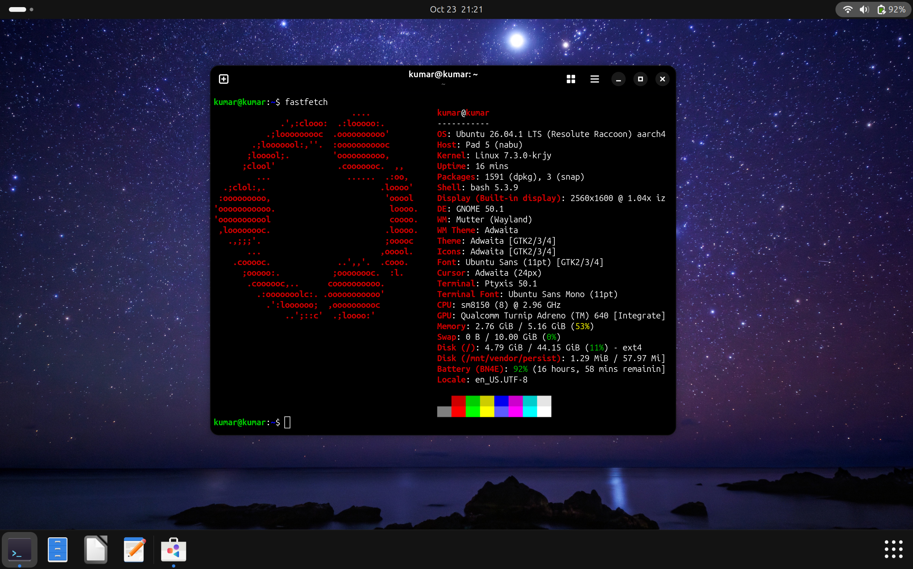

# Ubuntu Linux on Xiaomi Pad 5 (nabu) - Installer & Guide



An all-in-one installer and rootfs build for running **Ubuntu 26.04 LTS (Resolute Raccoon)** with hardware acceleration on the **Xiaomi Pad 5 (*nabu*)**.

---

## 📑 Table of Contents

- [Requirements](#-requirements)
- [Hardware Support Status](#-hardware-support-status)
- [Installation](#-installation)
  - [1. Partitioning (if not already done)](#1-partitioning-if-not-already-done)
  - [2. Method A: Flash via TWRP / Recovery (Recommended)](#2-method-a-flash-via-twrp--recovery-recommended)
  - [3. Method B: Flash via Fastboot (PC / Mac / Linux)](#3-method-b-flash-via-fastboot-pc--mac--linux)
  - [4. Triple-Boot (Windows + Android + Ubuntu)](#4-triple-boot-windows--android--ubuntu)
- [First Boot Setup](#-first-boot-setup)
- [Kernel Updates & Custom Kernels](#-kernel-updates--custom-kernels)
- [Post-Installation Tips](#-post-installation-tips)
- [Troubleshooting & Known Issues](#-troubleshooting--known-issues)
- [Credits & Thanks](#-credits--thanks)

---

## 🛠 Requirements

- **Xiaomi Pad 5 (*nabu*)** with an **unlocked bootloader**.
- [Modified TWRP](https://github.com/Kumar-Jy/twrp_device_xiaomi_nabu/releases/tag/mod-hybrid) (supports on-device partitioning).
- `ubuntu-nabu-installer.zip` from GitHub Releases / Actions.
- USB-C cable and a PC with Android Platform Tools (`fastboot` / `adb`) installed.

---

## 📊 Hardware Support Status

| Category | Hardware Feature | Status | Notes |
| :--- | :--- | :---: | :--- |
| **Display** | 2.5K WQHD+ LCD (2560x1600 @ 120Hz) | ✅ Working | Novatek NT36523 panel driver, smooth 120Hz refresh rate |
| **Touch** | Capacitive Multi-touch | ✅ Working | 10-point multi-touch supported out of the box |
| **Graphics** | 3D GPU Acceleration (Adreno 640) | ✅ Working | Mesa Turnip (Vulkan 1.3) & Freedreno (OpenGL 4.6) |
| **Audio** | Quad Stereo Speakers | ✅ Working | Cirrus Logic CS35L41 quad amplifiers via ALSA UCM (`xiaomi-nabu-alsa`) |
| **Microphone** | Built-in Mic Array | ✅ Working | Clear audio recording via ALSA / PipeWire |
| **Wireless** | Wi-Fi 5 (802.11ac 2.4/5GHz) | ✅ Working | Qualcomm WCN3990 via NetworkManager |
| **Bluetooth** | Bluetooth 5.0 | ✅ Working | Qualcomm WCN3990 via BlueZ |
| **Sensors** | Accelerometer, Gyroscope & Compass | ✅ Working | SLPI / SSC via FastRPC & `iio-sensor-proxy` |
| **Screen Rotation** | Automatic Screen Rotation | ✅ Working | Automatic orientation supported via Wayland / GNOME |
| **Stylus (Input)** | Xiaomi Smart Pen | ✅ Working | Pressure levels, tilt, and hover via driver |
| **Battery & Power** | Battery Gauge & Charging | ✅ Working | PM8150B charger driver, 15W USB-PD and QC charging |
| **Sleep / Wake** | Suspend & Resume | ✅ Working | S2idle sleep supported |
| **USB** | USB Type-C 2.0 & OTG | ✅ Working | Flash drives, keyboards, hubs, and mice supported |
| **External Display** | USB DisplayLink Output | ✅ Working | Supported with DisplayLink docks (`evdi` driver) |
| **External Display** | USB-C DisplayPort Alt-Mode | ❌ Not Supported | Hardware limitation (SoC USB lines lack DP routing) |
| **DRM** | Widevine L1 (HD Streaming) | ❌ Not Supported | Widevine L3 software works; L1 requires Android TEE |

---

## 💾 Installation

### 1. Partitioning (if not already done)

If your device doesn't have the required `esp` and `linux` partitions:

1. Put your tablet into **Fastboot Mode** (Hold `Power + Volume Down`).
2. Boot into TWRP:
   ```bash
   fastboot boot twrp.img
   ```
3. In TWRP, navigate to **Advanced > Terminal** and run:
   ```bash
   partition
   ```
   Follow the on-screen prompts to configure your layout:
   * **Dual-Boot (Android + Ubuntu):** Keeps Android and allocates `linux` + `esp`.
   * **Triple-Boot (Android + Windows + Ubuntu):** Allocates `win` + `linux` + `esp`.
4. Reboot recovery: Go to **Reboot > Recovery**.

---

### 2. Method A: Flash via TWRP / Recovery (Recommended)

1. Download the `ubuntu-nabu-installer.zip`.
2. Connect your tablet in TWRP recovery to your PC:
   ```bash
   adb push ubuntu-nabu-installer.zip /sdcard/
   ```
   *(Or copy it via MTP file transfer).*
3. In TWRP, tap **Install**, select `ubuntu-nabu-installer.zip`, and swipe to confirm.
4. **What the installer does automatically:**
   - Formats `/dev/block/by-name/linux` with ext4.
   - Extracts the Ubuntu rootfs image directly to the partition.
   - Sets up the ESP partition with rEFInd bootloader, GopRotate driver, and Ubuntu UKIs.
   - Patches the Android `boot` partition with DualBootKernelPatcher (DBKP) + UEFI payload.
5. Tap **Reboot > System**.

---

### 3. Method B: Flash via Fastboot (PC / Mac / Linux)

1. Extract `ubuntu-nabu-installer.zip` on your computer.
2. Put the tablet into **Fastboot Mode** (Hold `Power + Volume Down`).
3. Connect the tablet to your PC with USB.
4. Run the flash script:
   - **Windows:** Double-click `flash-linux.bat`
   - **Linux / macOS:**
     ```bash
     chmod +x flash-linux.sh
     ./flash-linux.sh
     ```
5. The script checks partition sizes, formats, flashes `rootfs.img` and `esp.img`, and reboots into rEFInd.

---

### 4. Triple-Boot (Windows + Android + Ubuntu)

If you have Windows installed:
1. When flashing `ubuntu-nabu-installer.zip`, the installer detects your existing Windows BCD and safely configures rEFInd alongside Windows Boot Manager.
2. In rEFInd, you can choose between **Android**, **Windows**, and **Ubuntu** on every boot.

---

## 👤 First Boot Setup

On first boot, Ubuntu will start the standard GNOME initial setup wizard. Follow the on-screen prompts to set your preferred language, keyboard layout, Wi-Fi connection, and create your personalized user account and password.

---

## 🔄 Kernel Updates & Custom Kernels

This rootfs includes an automatic UKI generator hook (`/etc/kernel/postinst.d/zz-update-uki`).

### Installing Local or Custom Kernel `.deb`s

When you build or download custom kernels (e.g. from upstream Linux):
```bash
sudo dpkg -i linux-image-*.deb linux-headers-*.deb
```
**What happens automatically:**
1. `dracut` generates the system initramfs (`/boot/initrd.img-<version>`).
2. `zz-update-uki` bundles the kernel image, DTB (`sm8150-xiaomi-nabu.dtb`), and initramfs into a Unified Kernel Image (`.efi`).
3. It mounts your ESP partition and copies the `.efi` directly to `EFI/Ubuntu/`.
4. The new kernel appears in the rEFInd boot menu on your next restart!

### System Updates
```bash
sudo apt update
sudo apt upgrade
```
*(Or use the included shortcuts: `sau` and `saug`).*

---

## 💡 Post-Installation Tips

### Handy Terminal Aliases

The pre-installed `.bash_aliases` provides shortcuts to save typing:

| Shortcut | Command | Description |
| :--- | :--- | :--- |
| `sau` | `sudo apt update` | Refresh package indexes |
| `saug` | `sudo apt upgrade` | Upgrade installed packages |
| `sai <pkg>` | `sudo apt install <pkg>` | Install an APT package |
| `sap <pkg>` | `sudo apt purge <pkg>` | Purge an APT package |
| `ssi <pkg>` | `sudo snap install <pkg>` | Install a Snap package |
| `..` / `...` | `cd ..` / `cd ../..` | Directory navigation |

### Recommended Apps

```bash
# Web browser
sudo snap install firefox

# Media player
sudo apt install vlc

# Local file sharing
sudo snap install localsend
```

---

## ⚠️ Troubleshooting & Known Issues

> [!TIP]
> For a detailed, step-by-step diagnostic and fix guide for kernel errors, sensors, cameras, and hardware video decode, please see the **[Troubleshooting Guide (TROUBLESHOOTING.md)](TROUBLESHOOTING.md)**.

1. **Missing Audio, Cameras, Auto-Rotation & Brightness (Older Installs):**
   - If audio, cameras, or sensors do not work after updating, see the [All-in-One Hardware Fix in TROUBLESHOOTING.md](TROUBLESHOOTING.md#1-fix-missing-audio-cameras-auto-rotation--brightness-existing--older-installs).
2. **Kernel Boot / Black Screen (Samsung UFS):**
   - Some Pad 5 units use Samsung UFS chips which can be timing-sensitive on certain mainline kernels. If a kernel hangs on boot, hold the **Power Button** for 10 seconds to reboot.
   - The installer ships with the latest optimized kernel 7.3 (`linux-image-7.3*`). Additional kernels can be installed via `nabu-pkgs`.
3. **Kernel Upgrade / dpkg crash (`kdump-tools` / `/dev/root`):**
   - Run `sudo apt purge -y kdump-tools makedumpfile crash && sudo dpkg --configure -a`. See [TROUBLESHOOTING.md](TROUBLESHOOTING.md#2-kernel-upgrade--installation-errors-kdump-tools--devroot) for permanent fix.
4. **Sensors / Auto-Rotation / Auto-Brightness:**
   - Requires `hexagonrpcd` service running to serve SLPI DSP sensor registry. See [TROUBLESHOOTING.md](TROUBLESHOOTING.md#4-sensors-auto-rotation--auto-brightness).
5. **Hardware Video Decoding (Iris):**
   - Add `options qcom_iris allow_fw_boot=1` to `/etc/modprobe.d/qcom-iris.conf`. See [TROUBLESHOOTING.md](TROUBLESHOOTING.md#5-hardware-video-acceleration-qualcomm-iris-hw-decoderencoder).

---

## 🤝 Credits & Thanks

- **[TheMojoMan](https://github.com/TheMojoMan)** — Original Xiaomi Pad 5 Ubuntu port, packaging, and kernel maintainer.
- **[Kumar_Jy](https://github.com/Kumar-Jy)** — Unified installer development, automation, and rootfs maintenance.
- **[ArKT-7](https://github.com/ArKT-7)** — TWRP Linux recovery modifications and partitioning utilities.
- **[rodriguezst](https://github.com/rodriguezst)** — Android bootloader dual-boot patcher (DBKP).
- **[Canonical](https://ubuntu.com)** — Ubuntu Linux.
- **[sm8150-mainline](https://gitlab.com/sm8150-mainline)** — Mainline Linux kernel port for Qualcomm SM8150.
